###  Yōkoso, I'm Yassir

22, from Morocco, doing my engineering degree in AI at ENSA Al Hoceima (graduating 2027).

Most of my time goes into making LLMs actually useful: fine-tuning them, plugging them into real documents, and teaching them to say "I don't know" instead of making stuff up. When I get tired of GPUs, I go bother an ESP32.

&nbsp; My RAG pipelines cite their sources. My school essays never did. 
&nbsp; I've lost more nights to Docker networking than I'd like to admit. 
&nbsp; Fastest way to get my attention: send me a weird dataset or a cursed bug. 
&nbsp; I speak Arabic, French and English, and I'm slowly losing a fight with Chinese and German. 
&nbsp; Powered by Moroccan mint tea. Yes, too much sugar.

  

&nbsp; **ORION** is my research playground. Vision models, time series and knowledge graphs, glued together with LangGraph agents so they can reason about factory sensors and images at the same time. Very much a work in progress.

&nbsp; **Sentinel** is MLOps on AWS/EKS that deploys models, watches them for drift and rolls back on its own. The goal is simple: I want to sleep.

&nbsp; **Some proof I don't just talk:** Global UGRAD semi-finalist (2023–24), Oracle OCI AI Foundations certified, two IBM courses on Istio & Kubernetes, and an n8n + Canva pipeline that cut 90% of the manual work at my last internship.

  

 

&nbsp; **Want to build something together, offer me an internship, or just show me a cursed bug?** 
My [LinkedIn](https://linkedin.com/in/yassir-hamri) DMs are open.

