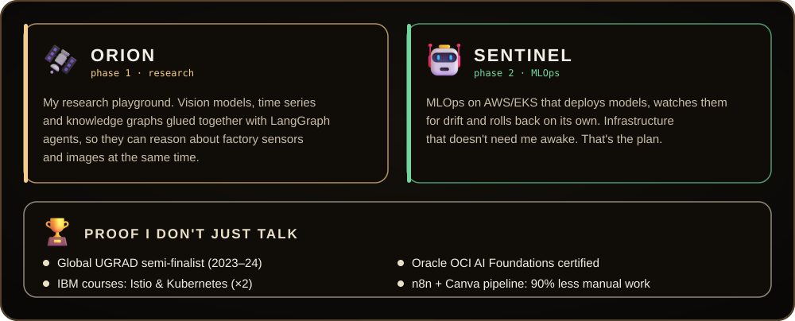



  

  

  

  

  

  

&nbsp; **Want to join my side before I stand in the heavens?** 
Internships, collabs or cursed bugs: my [LinkedIn](https://linkedin.com/in/yassir-hamri) DMs are open.

 

